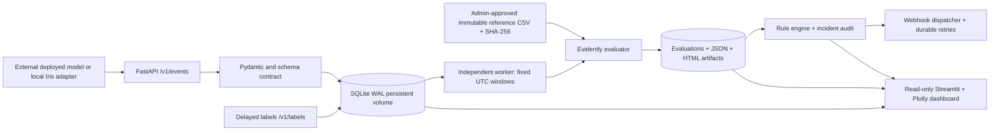
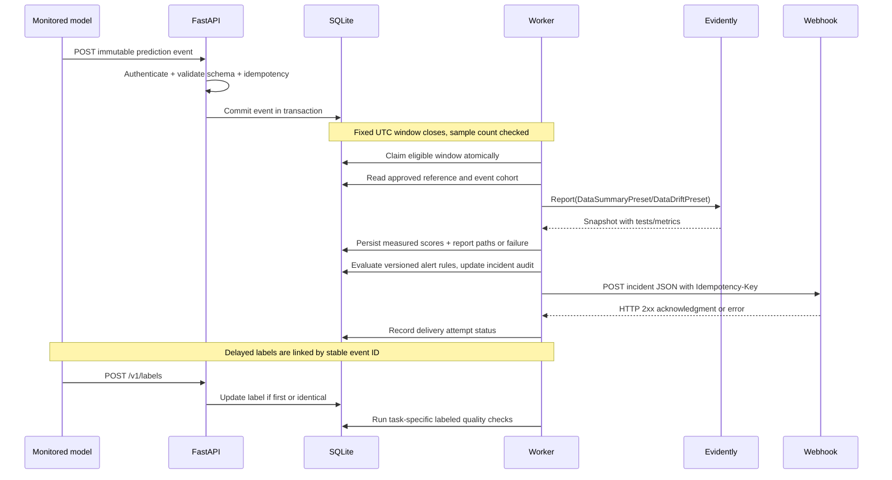

# Architecture, method, and operational boundaries

## System topology

## Statistical choices

- **Reference population:** 53-row stratified holdout of the public scikit-learn Iris dataset (`random_state=42`), separately from the 97 training rows. The model is a standardized multiclass logistic regression pipeline. Baseline performance is computed once from the holdout's targets and predictions; no model performance is inferred without labels.
- **Drift:** pinned Evidently 0.7.23 `Report([DataDriftPreset(columns=..., method='psi', threshold=0.2)])`, run separately on feature columns and prediction column. The Population Stability Index (PSI) threshold of 0.2 is a demonstration threshold, not a universally calibrated significance level. Larger PSI indicates greater histogram change. Prediction is categorical for classification. Scores are extracted from `Snapshot.json()`'s documented metric `config.column`, `metric_name=ValueDrift(...)` and scalar `value`. Extraction fails closed on API changes. Evidently HTML/JSON are persisted alongside a normalized DB summary.
- **Data quality:** Evidently `DataSummaryPreset` with tests, complemented by exact schema contract validation at ingestion, per-column missing rates, error/latency counts. Unexpected categories/ranges/types reject ingestion, separately from *distributional* drift. Allowed missingness can be bounded in `max_missing_rates`.
- **Classification:** exact classification counts, accuracy, macro precision/recall/F1 and confusion matrix. Binary ROC-AUC only when binary scores and usable labels are present.
- **Regression:** MAE, RMSE, R², residual mean/std, requiring numeric target and prediction. The example configuration has no regression model; the metric functions and typed event path are task-generic.
- **Performance alert:** observed accuracy below approved baseline accuracy minus `performance_accuracy_drop`, or RMSE above approved baseline RMSE plus `performance_rmse_increase`. A minimum labeled sample count is required. Ground-truth coverage is exposed, to surface selection bias.

Default `min_events=30`, `min_labels=20`, `alert_persistence=2`, `alert_recovery=2` are pedagogical. For confidence intervals, robust tests, multiple comparisons, seasonality, class imbalance, and segments, calibrate with historical legitimate deployment data before production use. A high PSI is **not** evidence of model error or concept drift. True concept drift concerns changes to `P(y | X)`; additional labeled cohorts, statistical uncertainty and analysis of feature-target relationships are required. This app describes measured performance loss as *observed degradation*, not confirmed concept drift.

## Window and failure semantics

- Fixed UTC event-time interval `[start,end)`; worker checks up to 48 recent closed windows after the first observed event. Older time intervals can be created through the privileged manual endpoint.
- Underfilled windows remain `insufficient`, zero-event windows remain `empty`. They are not counted as successful drift checks. Availability evaluations separately detect missing monitoring traffic and rejected ingestion requests after traffic has commenced.
- Window claims are recorded as `running` before invoking Evidently. A crash is detected on worker restart and marked `failed`, not silently treated as success. A failed drift check is not retried automatically because the same window may have changed; the incident must be investigated. Re-evaluation under a new run identity is a future enhancement.
- A `label_count` revision creates a new performance evaluation when the labeled cohort grows. A second performance evaluation on the same window cannot count as a separate failure toward alert persistence.
- Events may arrive out of event-time order; a completed window retains its original evaluation. Very late events remain in storage but do not mutate the completed snapshot. The dashboard shows the snapshot's event count, not necessarily a later re-count. Late-event rates are not yet separately instrumented.
- References are approved through administrative workflows, immutable by name and hash. Switching `config.json` to a new approved version requires controlled redeployment. There is no automatic baseline replacement.

## Alert lifecycle

Each rule has a policy fingerprint, model version, and reference version in its grouping key. Two *distinct eligible* failing windows create one incident by default. Subsequent failures append an audit observation rather than creating duplicate incidents. Two healthy evaluated windows resolve it. A recurrence reopens it. Operators can acknowledge and resolve with notes; silent/no evaluation is not a healthy sample.

The dispatcher sends JSON webhooks. **Delivered** means the destination returned HTTP 2xx. Transport failure, 4xx/5xx and timeout create durable `failed` attempt rows and exponential retry backoff. An unset URL produces `unconfigured`, never `delivered`. Idempotency headers help cooperative receivers deduplicate. A cooldown controls re-notification after prior delivery. Webhook destination is an administrator-owned environment variable, not user-controlled per request.

## Privacy, limits, and threat model

- Features and predictions are persisted for approved schema columns, so do not use personal/sensitive attributes without governance and permission. No generic arbitrary metadata or freeform PII columns are permitted. Bearer tokens separate ingestion from privileged management.
- The dashboard uses *direct local DB access* and is intended for loopback/operator-controlled deployments; it has **no own login**. Do not expose it publicly. Compose binds ports to `127.0.0.1`. Expose FastAPI behind a TLS reverse proxy with proper token lifecycle, shared distributed rate limiting, and tenancy controls for real deployments.
- Raw events and ingestion rejection records are deleted by the worker after `retention_days` (subject to the worker running). Aggregated historic reports are retained; artifact-retention controls and compliant data-erasure workflows are not implemented.
- SQLite WAL serializes multiple writers for small local deployments. For multi-instance concurrent load, replace with PostgreSQL and a transactionally leased work queue. The per-process rate limiter is not distributed. A single worker should be deployed with the supplied Compose configuration.
- Model pickle (`joblib`) must only be loaded from artifacts trusted by the operator, never user uploads. Inference is a sample adapter, not a general model-serving gateway.

## Deployment architecture notes

The Compose stack uses one short-lived preparation service, API, worker, dashboard, and three named volumes. The API and dashboard health checks test HTTP readiness. Docker image runs as a non-root UID and uses exec-form commands. There is no PostgreSQL migration, automatic horizontal autoscaling, high-availability job queue, production secrets manager, or built-in HTTPS. Treat these as remaining engineering work, not implemented properties.
